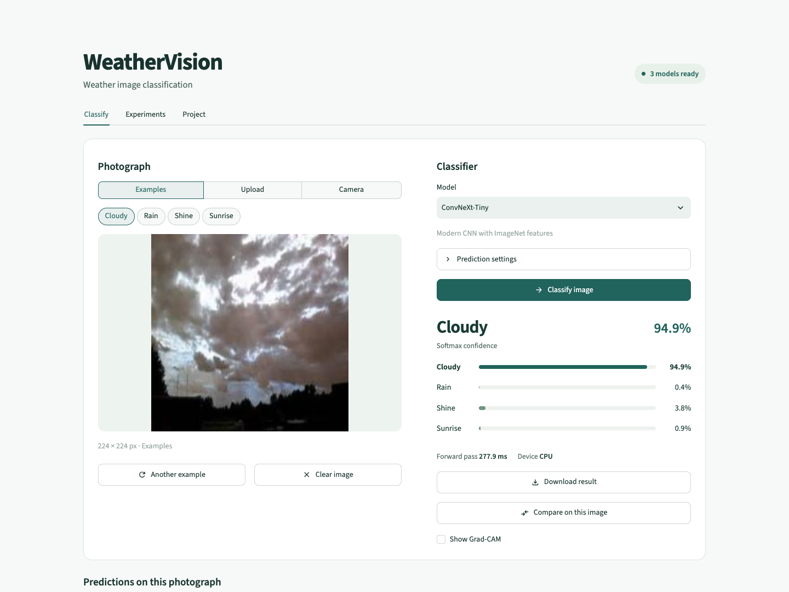

# WeatherVision

**Author:** Rakhman Seidigali  
**Group:** SE-2411  
**Course:** Computer Vision, Astana IT University  
**Instructor:** Nurym Kaiyrkhan

WeatherVision classifies photographs as **Cloudy, Rain, Shine, or Sunrise**. The project compares Simple CNN, MobileNetV2, and ConvNeXt-Tiny using a shared dataset split, and includes an augmentation ablation, Grad-CAM explanations, and a Streamlit application.



[Demo video — 4:08](https://github.com/commedeschamps/WeatherVision/releases/download/v1.0.0/WeatherVision_demo.mp4) · [Public repository](https://github.com/commedeschamps/WeatherVision) · [Model releases](https://github.com/commedeschamps/WeatherVision/releases) · [Local run guide](docs/LOCAL_RUN_GUIDE.md)

## Results

All four experiments were trained on Apple MPS and evaluated on the same 165 test images.

| Configuration | Accuracy | Macro precision | Macro recall | Macro-F1 | Mean / median forward time, ms |
|---|---:|---:|---:|---:|---:|
| Simple CNN | 0.9515 | 0.9489 | 0.9473 | 0.9477 | 0.729 / 0.742 |
| MobileNetV2 | 0.9636 | 0.9624 | 0.9625 | 0.9620 | 12.171 / 10.269 |
| ConvNeXt-Tiny + augmentation | 0.9818 | 0.9866 | 0.9795 | 0.9827 | 6.716 / 6.494 |
| ConvNeXt-Tiny without augmentation | 0.9758 | 0.9798 | 0.9727 | 0.9759 | 6.310 / 6.273 |

Complete results are stored in `outputs/model_comparison.csv`, per-run `test_metrics.json`, and `test_predictions.csv`. The augmentation ablation increases accuracy by one correct prediction and macro-F1 by 0.0068 under the shared protocol.

## Installation and local application

```bash
git clone --branch technical/explainability-validation https://github.com/commedeschamps/WeatherVision.git
cd WeatherVision
python3 -m venv .venv
source .venv/bin/activate
python -m pip install -r requirements.txt
export MPLCONFIGDIR="$PWD/.cache/matplotlib"
export TORCH_HOME="$PWD/.cache/torch"
python scripts/download_checkpoints.py
python -m streamlit run app.py
```

Open the local URL printed by Streamlit. Select a model, upload a JPG/PNG/WebP or choose a test image, then press **Classify image**. The app displays the prediction, four softmax scores, single forward time, optional average benchmarking, device and environment, and optional ConvNeXt Grad-CAM. Camera input is also available.

The **Examples**, **Upload**, and **Camera** controls select the image source. Examples open immediately; **Another example** cycles through the selected category. **Clear image** starts a new upload. **Compare on this image** runs the available model families on the same photograph and provides a CSV export.

After prediction, **Download result** exports the class scores, backend/environment, forward time and server prediction time as JSON. Under **Timing and environment**, **Measure average latency** performs five warm-ups and 30 synchronized measurements on demand. This result is cached for the same image, model, device and checkpoint; ordinary predictions skip those 35 extra forwards. For ConvNeXt, **Show Grad-CAM** displays the explanation without clearing or recomputing the prediction. The heatmap can be downloaded as PNG. The **Experiments** tab contains test metrics and an interactive comparison chart; **Project** contains the team, dataset, and PDF report downloads.

The setup command downloads three trained `best.pt` files from GitHub Releases and validates their sizes and SHA-256 hashes against `configs/checkpoints.json`. Add `--all` to obtain the non-augmented ablation checkpoint. The total download is about 115 MiB for the app or 221 MiB for all four models. Weights are distributed separately from Git history. Run `python weather_cv.py prepare` to enable dataset examples; uploads work without downloading the dataset. Models are cached during application use, and uploaded images are processed in memory. CPU is the default inference device; automatic selection supports CUDA and Apple MPS.

Runtime dependencies are in `requirements.txt`. Test, notebook, and PDF tools are in `requirements-dev.txt`. The tested local environment uses Python 3.14.5, Torch 2.10.0, and TorchVision 0.25.0; `requirements-lock-local.txt` records its package versions. Python 3.11 or 3.12 can also be used with the compatible dependency ranges.

## Dataset and preprocessing

Source: Gbeminiyi Ajayi (2018), *Multi-class Weather Dataset for Image Classification*, Mendeley Data, V1, [DOI 10.17632/4drtyfjtfy.1](https://doi.org/10.17632/4drtyfjtfy.1), CC BY 4.0. The project uses the resized [PerceptiLabs mirror](https://github.com/PerceptiLabs/Weather-Analysis), pinned to commit `ad78ac8fcf1b1aae229ca6e5310aa75b06783787`.

The downloaded files contain 1,123 valid weather images. The audit removes 26 exact duplicates and retains 1,097 images in 1,011 groups. It also records 97 near-duplicate candidate pairs. The split uses seed 42 and assigns each detected duplicate group to a single partition.

| Category | Train | Validation | Test |
|---|---:|---:|---:|
| Cloudy | 204 | 43 | 44 |
| Rain | 143 | 31 | 31 |
| Shine | 175 | 37 | 37 |
| Sunrise | 246 | 53 | 53 |
| Total | 768 | 164 | 165 |

Preparation verifies image decoding, detects exact copies using file and pixel SHA-256, and groups near duplicates using pHash, dHash, aspect ratio, and thumbnail color distance. The manifest records paths, labels, class indices, content hashes, groups, and splits. Training and evaluation verify the image hashes.

Images use shorter-side resizing, a 224 center crop, and ImageNet normalization. MobileNetV2 uses resize 256; ConvNeXt uses 236; the CNN uses 256. Training augmentation combines horizontal flips, rotations up to 8 degrees, and mild color jitter. Validation and test preprocessing are deterministic.

```bash
python weather_cv.py prepare
# Manual archive alternative:
python weather_cv.py prepare --local-zip /absolute/path/Weather-Analysis.zip
```

Dataset statistics and visualizations are in `data/statistics.json`, `class_distribution.csv/.png`, and `inspection.png`. The detailed audit is in `image_audit.csv`, `duplicate_pairs.csv`, and `corrupted_images.csv`.

## Training, evaluation, and reproducibility

```bash
python scripts/run_all.py --resume
```

The runner prepares the dataset, trains the four configurations, evaluates their validation-selected checkpoints, generates Grad-CAM examples, and builds the reports. It reuses completed runs when configuration and manifest agree. Interrupted runs restore model and optimizer states.

Individual commands:

```bash
python weather_cv.py train --run cnn_baseline --skip-complete
python weather_cv.py train --run mobilenet_improved --skip-complete
python weather_cv.py train --run convnext_aug --skip-complete
python weather_cv.py train --run convnext_noaug --skip-complete
python weather_cv.py evaluate --runs cnn_baseline mobilenet_improved convnext_aug convnext_noaug
python weather_cv.py explain --run convnext_aug --count 6
python weather_cv.py figures
python scripts/build_reports.py
```

Hyperparameters are stored in `configs/experiments.yaml`. All runs use cross-entropy, AdamW, weight decay 0.0001, and seed 42. Epoch limits are 12/8/6/6; batch sizes are 32/32/16/16. Validation macro-F1 selects the checkpoint, with the earliest epoch retained on a tie and early-stopping patience of four epochs.

The Simple CNN trains all 23,956 parameters. MobileNetV2 and ConvNeXt use frozen ImageNet-1K V1 features and train a new four-class linear head, containing 5,124 and 3,076 parameters respectively. The two ConvNeXt configurations differ only in training augmentation.

Latency uses five warm-up forwards and 30 synchronized batch-one measurements of the same device-resident test tensor. The table reports the arithmetic mean and median forward-pass time. Decoding, preprocessing, transfer, model loading, and softmax are excluded from this benchmark. Raw timings and hardware metadata are stored in each run's `test_metrics.json`.

Grad-CAM uses ConvNeXt `features[-1]`, enables input gradients for the frozen extractor, and maps the normalized heatmap back through the center-crop geometry. Six examples include correct and incorrect test predictions. The original images and heatmaps are stored separately.

## Validation

```bash
python -m pytest -q
python scripts/verify_project.py
python scripts/smoke.py
```

Automated tests cover class mapping, grouped splits, leakage rejection, duplicate/corruption checks, configuration loading, model output shapes, checkpoint round trips, CPU inference, metrics, Grad-CAM geometry, interrupted-run resume, and portable dataset restoration. The separate smoke test performs one real-data epoch per experiment using four images per class per split; its files are isolated under `outputs/smoke/`.

Optional browser checks, with Streamlit running:

```bash
python -m pip install -r requirements-ui.txt
# Use installed Chrome on macOS, or install Playwright Chromium:
python -m playwright install chromium
python scripts/check_app.py
```

The browser test checks a trained CPU prediction, Grad-CAM, the comparison tab, mobile layout, and invalid image uploads. Evidence and captures are in `outputs/app/`. The full saved-output audit is in `outputs/verification.json`.

## Reports, notebook, and presentation

- [Assignment 1 report](reports/assignment1_foundation.pdf)
- [Assignment 2 report](reports/assignment2_report.pdf)
- [Google Colab notebook](notebooks/WeatherVision_Colab.ipynb)
- [Defense guide and 40 questions](docs/DEFENSE_GUIDE.md)
- [Presentation script and storyboard](docs/DEMO_SCRIPT.md)
- [References](docs/references.bib)

The Colab notebook runs the same pipeline and supports dataset caching, resumed training, GPU selection, output export, and saving to Google Drive. Create the source archive, upload it in the first notebook section, and run the cells in order.

```bash
python scripts/package_project.py
python scripts/package_project.py --results
```

The archives are saved as `dist/WeatherVision_source.zip` and `dist/WeatherVision_results.zip`. Raw images, caches, virtual environments, secrets, and smoke-test artifacts are excluded. The results archive includes full trained checkpoints and experiment outputs. Source-only extraction can restore the pinned dataset while preserving the saved manifest.

Team information is stored in `configs/submission.yaml`. Optional repository and video URLs can be added there and included when the reports are regenerated.

```text
app.py, weather_cv.py     application and command line
src/                     data, models, training, evaluation, Grad-CAM, plots
configs/                 experiment settings and project team
scripts/                 training runner, validation, reports, packaging
notebooks/               Google Colab notebook
tests/                   automated tests
data/                    manifest, audit, statistics, visualizations
outputs/                 checkpoints, metrics, predictions, figures
reports/                 Markdown and PDF reports
docs/                    defense, demo, bibliography, validation record
```

## Limitations and media

The held-out set has 165 images and the comparison uses one seed. Ambiguous scene labels, unusual lighting, camera settings, and unseen locations can affect generalization. Softmax scores are uncalibrated. Grad-CAM is an approximate spatial attribution. The training data contains 0% synthetic/generated images; flips, rotation, and color jitter transform existing training photographs. Test fixtures are separate from the training dataset.

## Final submission

- [A2 report](reports/assignment2_report.pdf), [A1 foundation](reports/assignment1_foundation.pdf).
- [Executed notebook](notebooks/WeatherVision_Colab.ipynb): validated locally using nbclient/ipykernel; hosted Colab execution is not claimed.
- [Requirement audit](docs/FINAL_REQUIREMENTS_AUDIT.md) and [verification log](docs/FINAL_VERIFICATION_LOG.md).
- [Demo script](docs/FINAL_DEMO_SCRIPT.md) and [recording plan](docs/DEMO_RECORDING_PLAN.md).
- [Defense guide](docs/DEFENSE_GUIDE.md).

The demonstration video uses explicitly disclosed synthetic English narration over an actual application screen recording. No generated images are used for training.

For a new training comparison that preserves released outputs, pass `--outputs outputs/retrained` to each train/evaluate command. In a separate notebook training copy, move `outputs/` to `outputs_saved/` before starting and set `USE_RELEASED_CHECKPOINTS=False`.

## Technical validation update

The `technical/explainability-validation` branch adds a raw Grad-CAM view, a relative-color legend, opacity control and an experimental earlier-stage view. The final 7×7 stage remains the default; the earlier stage is 14×14. Both stage and backend choices use direct radio controls. Changing opacity redraws the overlay while preserving the attribution and prediction.

The 22-image, equal-area occlusion experiment includes every saved error and all six original explanation examples. High-attribution final-stage regions outperform random controls in 21/22 mean-replacement cases and 18/22 blur cases. Baseline-dependent counterexamples are included in the analysis.

- [Explainability methods and results](docs/EXPLAINABILITY_VALIDATION.md)
- [Validation/test gap, augmentation and ablation recheck](docs/VALIDATION_TEST_ANALYSIS.md)
- [Technical improvement report](docs/TECHNICAL_IMPROVEMENT_REPORT.md)

```bash
python scripts/validate_explanations.py --device auto
MPLCONFIGDIR=.cache/matplotlib TORCH_HOME=.cache/torch python scripts/audit_training_protocol.py
python scripts/profile_inference_policy.py
python -m pytest -q
```

New analyses are stored in outputs/explainability_validation and outputs/technical_audit. They preserve official checkpoints, predictions, metrics, histories, the dataset split, reports and original figures. The published Assignment 2 demo and submission assets remain versioned in their existing releases.
