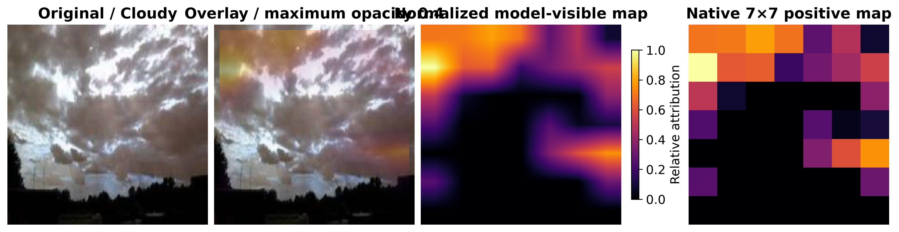
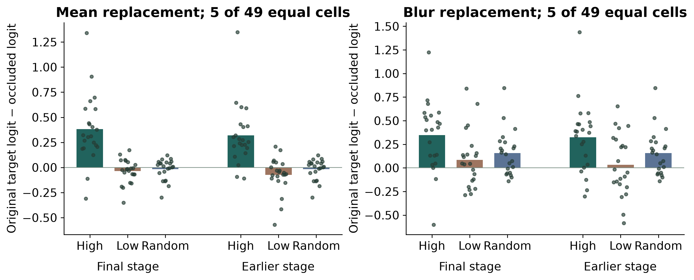
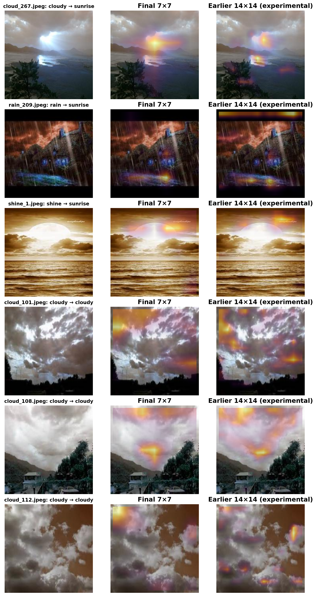

# Explainability validation

WeatherVision explains a selected class score with Grad-CAM. The final ConvNeXt spatial stage remains the default. A separate diagnostic experiment compares it with an earlier stage using equal-area image perturbations. The trained models and official test results are unchanged.

## Calculation and stage selection

For class logit z_c and spatial activation A_k, the channel weight is the spatial average of dz_c/dA_k. The native map is ReLU(sum_k weight_k × A_k). The implementation differentiates the logit before softmax, following [Selvaraju et al., Grad-CAM](https://arxiv.org/abs/1610.02391).

- Final stage: `features[7]` / `features[-1]`, tensor **1×768×7×7**, before global pooling and classifier LayerNorm.
- Earlier stage: `features[5]`, tensor **1×384×14×14**, before the next downsampling operation. It provides a complementary intermediate-feature attribution.

A forward hook captures one NCHW tensor. The input is cloned with gradients enabled, including when the caller entered inference mode. `autograd.grad` computes the selected-logit derivative without updating parameters or their gradient buffers. The hook is removed in a finally block. Every submodule's original train/eval flag is restored separately, including a frozen eval-mode extractor under a training head.

The positive map is resized bilinearly to 224×224 with `align_corners=False`, then receives the existing within-map min/max scaling. A constant map remains zero and is labeled as having no spatial contrast. Invalid targets, non-finite inputs/activations/gradients and unsupported stages are rejected.

Both layers are normalized separately. Their colors are relative within each map; the displayed intensities are not directly comparable between layers or images. Higher spatial resolution alone does not establish greater faithfulness.

## Original maps and the horizon question

All six preserved Grad-CAM examples were recomputed. Maximum absolute change against the saved final-stage arrays was **2.39×10⁻⁷**. Maximum CPU/MPS difference was **4.53×10⁻⁶**. The direct-gradient formula, tensor shapes, finite range, deterministic outputs, hook cleanup and unchanged model state are covered by tests. Evidence: `outputs/technical_audit/gradcam_numerical_parity.json`.

For `cloud_267.jpeg`, the dataset label is Cloudy but the model predicts Sunrise. The explanation therefore targets the **Sunrise logit**. Its final-stage peak is at crop coordinates (row 80, column 112), near the bright horizon. The preserved correct Cloudy examples have different peaks: `cloud_101` near the upper left, `cloud_108` near the center and `cloud_112` at an edge. There is no single compulsory cloud-shaped pattern. In `cloud_101`, the raw map contains a secondary right-hand response, while the numerical maximum is at the upper left and the bottom third contains 10.3% of normalized map mass. Overlay contrast against the photograph can make that secondary patch visually prominent. The raw view separates the computed map from this display effect.

A final 7×7 grid is coarse. Interpolation smooths a few strong cells, while within-map normalization and attribution-weighted overlay opacity can make a compact response visually prominent. Image classification can use scene context and co-occurring backgrounds; it does not supply pixel labels. These observations explain how a horizon/background highlight can arise from the computed model response. They do not establish human-like understanding of clouds.

The audit found a separate rendering defect: bilinear mapping could tint a narrow boundary outside the geometric center crop. The controlled 224-square all-positive-map test changed 852 geometrically unseen pixels. The corrected renderer explicitly masks the crop at original-pixel centers and copies untouched pixels exactly. This boundary effect cannot account for a larger interior hotspot. The underlying CAM values were not edited to improve appearance.



## Display behavior

The app shows the original photograph and overlay, the predicted target class, native stage resolution, an Inferno legend, adjustable maximum opacity and an optional raw map of the model-visible crop. Opacity multiplies only the rendering strength; it does not modify the raw attribution, cached prediction or model weights. Raw/overlay PNG downloads and model/device/image cache separation are tested. Brighter colors indicate stronger relative positive attribution, rather than a segmentation mask or causal proof.

## Occlusion protocol

The diagnostic set contains **22 held-out images**: four seeded saved-correct examples per class, all three saved errors, and all six original explanation examples, with repeated IDs removed. It includes `cloud_267.jpeg`, `rain_209.jpeg` and `shine_1.jpeg`. Selection uses seed 42 and is listed in `outputs/explainability_validation/samples.csv`. This enriched set provides coverage, not an estimate over all weather photographs.

Each preprocessed 224×224 tensor is partitioned into a 7×7 grid of 32-square cells. Five cells are replaced in every intervention: **5,120 pixels / 10.20%** of the visible input. Cell means rank the CAM. High and low groups use its top/bottom five cells with deterministic tie-breaking. Ten uniformly sampled, without-replacement random masks use seed 42 plus the fixed sample index. Random masks are shared across the two layers and baselines for each image.

Two replacements are used: normalized zeros, corresponding to the ImageNet RGB mean [0.485, 0.456, 0.406], and a Gaussian-blurred version of the same input (31-square kernel, sigma 10). Only the selected cells are replaced. The original predicted class remains the target even when the perturbed prediction changes. The score is **original target logit minus perturbed target logit**; positive values mean a decrease. Softmax changes are saved as secondary measurements.

All inference runs in eval/inference mode using the existing ConvNeXt checkpoint on Apple MPS. Model tensors were compared before and after and remained equal. There are 1,056 perturbation records. Random repeats are first averaged within each image, then images receive equal weight in the summary.

## Observed results

| Stage | Replacement | High Δlogit | Low Δlogit | Random Δlogit | High > random |
| --- | --- | --- | --- | --- | --- |
| earlier | blur | 0.323 | 0.034 | 0.156 | 16/22 |
| earlier | mean | 0.320 | -0.074 | -0.017 | 22/22 |
| final | blur | 0.346 | 0.085 | 0.156 | 18/22 |
| final | mean | 0.381 | -0.037 | -0.017 | 21/22 |

For final-stage mean replacement, high regions exceed low and random controls in **21/22** cases. Under blur they exceed both in **18/22**. The earlier layer has more spatial detail but does not consistently improve these checks; the original final layer remains the default.

The error `cloud_267.jpeg` illustrates baseline sensitivity. With mean replacement, high/low/random final-stage logit drops are **+0.248 / −0.159 / −0.005**. With blur they are **−0.118 / −0.120 / −0.101**: all increase the original Sunrise logit. Its map should therefore not be described as universally confirmed by perturbation.





## Interpretation and limits

The aggregate score changes support the usefulness of high-ranked regions for this selected set and these interventions. Individual counterexamples remain. Replacement introduces an artificial distribution shift; mean and blur can remove or introduce different evidence. Equal area controls the deletion budget, but masks can differ in shape, location and interactions with surrounding context. A 32-pixel grid and five-cell budget test one spatial scale.

The experiment uses one checkpoint and one enriched sample, not repeated training seeds or external data. Ten random masks are a reference distribution, not a population confidence interval. Normalization is per map, and positive-only Grad-CAM omits suppressive contributions. No parameter-randomization or label-randomization study was performed. [Adebayo et al.](https://arxiv.org/abs/1810.03292) explain why visual plausibility alone is insufficient; the present experiment adds a limited perturbation check, not a complete saliency certification. Occlusion as a model-response probe follows the motivation of [Zeiler and Fergus](https://arxiv.org/abs/1311.2901).

## Reproduce

```bash
python scripts/download_checkpoints.py --all
python weather_cv.py prepare
python scripts/validate_explanations.py --device auto
```

Use `--device cpu` for CPU execution. The script writes only `outputs/explainability_validation/`. Settings, sample IDs, 44 compressed attribution files, per-mask JSON/CSV, paired scores and figures are included. It never trains or rewrites official evaluation artifacts.
