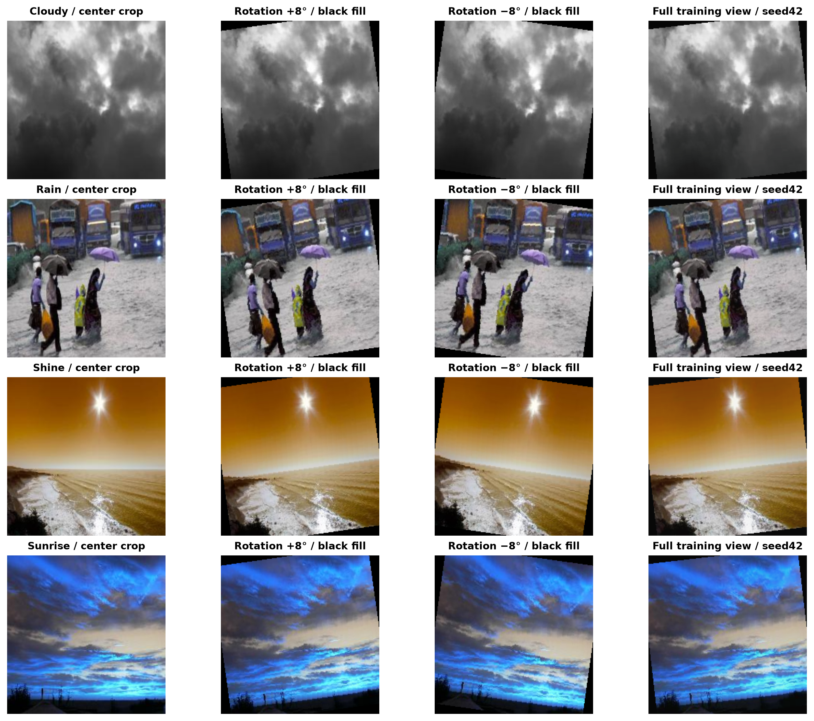

# Validation and test analysis

The saved best checkpoints were evaluated again on CPU using their original architecture-specific deterministic transforms. The analysis writes new validation predictions under `outputs/technical_audit/validation/`; official test CSV/JSON files remain unchanged. All **656 validation predictions** and **660 test predictions** were reconstructed. Every test label/prediction and all four validation macro-F1 values match the stored artifacts and selected training-history rows.

## Shared protocol and class counts

The manifest contains 768 training, 164 validation and 165 test images, using seed 42. Cloudy has 43 validation and 44 test images; Rain has 31/31, Shine 37/37 and Sunrise 53/53. This near-identical balance does not explain the CNN gap by a large difference in class proportions.

All retained file hashes and decoded-pixel hashes were recomputed. There are zero train/validation/test collisions for exact hashes, pixel hashes or detected group IDs. Class-index mapping is consistent. All four checkpoints reference the same manifest. Validation/test transforms have no random augmentation; MobileNet/CNN resize to 256 and ConvNeXt to 236 before a 224 center crop and ImageNet normalization. Loaded models have all modules in eval mode, and inference performs no parameter or BatchNorm adaptation.

Duplicate grouping is heuristic: pHash/dHash thresholds, aspect ratio and thumbnail color similarity can miss heavy crops, edited versions or related scenes, and can merge similar textures. Group disjointness verifies the detected components, not every possible source-scene relationship. The fixed split was preserved.

## Reconstructed results

| Model | Best epoch | Validation correct | Validation F1 | Test correct | Test F1 | F1 gap |
| --- | --- | --- | --- | --- | --- | --- |
| cnn_baseline | 9 | 141/164 | 0.8544 | 157/165 | 0.9477 | +0.0933 |
| mobilenet_improved | 8 | 154/164 | 0.9390 | 159/165 | 0.9620 | +0.0230 |
| convnext_aug | 3 | 157/164 | 0.9579 | 162/165 | 0.9827 | +0.0248 |
| convnext_noaug | 5 | 157/164 | 0.9570 | 161/165 | 0.9759 | +0.0189 |

Checkpoint selection is the highest validation macro-F1, retaining the earlier epoch on a tie. The selected epochs agree with complete histories. Test results were not used to select new parameters.

| Class | CNN validation F1 | CNN test F1 |
| --- | --- | --- |
| Cloudy | 0.8090 | 0.9535 |
| Rain | 0.8571 | 0.9180 |
| Shine | 0.8000 | 0.9474 |
| Sunrise | 0.9515 | 0.9720 |

CNN makes 23 validation errors and 8 test errors. Its largest class-wise F1 gaps are Cloudy and Shine. Validation mean softmax confidence is **0.8509**, versus **0.8740** on test; mean predictive entropy is **0.4226**, versus **0.3871**. These are model-dependent uncertainty measures, not independent annotations of image quality or difficulty.

Across all four models, 136/164 validation images and 151/165 test images are unanimously correct. Three validation images and one test image are wrong for every model. This supports the descriptive observation that this validation subset is more challenging for the trained models. A human relabeling study was not performed, so class ambiguity is a plausible task limitation rather than an established explanation of each error.

## Sampling variability

A fixed-model descriptive bootstrap resamples whole detected groups within each class, independently in each split (2,000 repeats; seeds 42 and 43). For CNN, the central 95% resampling ranges are **0.7945–0.9069** for validation macro-F1, **0.9107–0.9804** for test, and **+0.0261 to +0.1602** for test-minus-validation.

The CNN difference stays positive over this resampling range. It should not be dismissed as automatically disappearing under small-sample resampling. The calculation is conditional on the selected checkpoint and observed groups; it does not identify a cause, account for all domain correlations or estimate training-seed variability. The transfer-model gap ranges include zero. Full values are in `outputs/technical_audit/protocol_analysis.json`.

The observed split-specific difficulty and sampling are compatible explanations for a gap. The reconstruction found no metric, checkpoint-selection or detected-duplicate leakage discrepancy. Establishing a population-level explanation would require independent environments, source-scene metadata and repeated training/split experiments.

## Rotation augmentation

The unchanged training recipe applies `RandomRotation(8)` after resizing and cropping. TorchVision's defaults use nearest-neighbor interpolation, no expansion and RGB fill zero. Controlled ±8° images show artificial black corners; at 8° the geometric fill occupies **6.07%** of the 224-square input. Four first-in-order training examples, one per class, and a seed-42 full augmentation view are saved separately.



Artificial dark areas can interact with appearance cues in dark weather scenes. These checks do not measure a learned reliance on those corners. A future matched experiment could compare reflection padding followed by rotation/cropping or another fill strategy. Changing the recipe requires new training; no transformation or trained result was changed here.

## Ablation recheck

Serialized architecture, pretrained weight identifier, seed, manifest, batch size, optimizer, learning rate, six-epoch limit and validation-selection procedure match; augmentation is the changed treatment. The two saved frozen backbones are byte-equal and match the official V1 backbone in the reconstruction. The model-construction file matches its recorded training-source hash.

Replaying construction in the recorded PyTorch/TorchVision environment produces identical initial heads for the two configurations. The original initial head tensors/checksums were not stored. Historical identity of those tensors is therefore not directly verified; configuration equality and deterministic replay are evidence about the procedure, not a saved measurement of the past initial state.

| Image | With augmentation | Without augmentation | Correctness change |
|---|---|---|---|
| shine_1.jpeg | Sunrise | Cloudy | Wrong in both |
| shine_123.jpeg | Shine | Cloudy | One additional correct image |

The models disagree on **two predicted labels**, while the net gain is **one correct answer** (162 versus 161 of 165). Macro-F1 changes from 0.9759 to 0.9827. This single-seed result does not support a statistical-significance or universal augmentation-benefit claim.

## Reproduce

```bash
MPLCONFIGDIR=.cache/matplotlib TORCH_HOME=.cache/torch python scripts/audit_training_protocol.py
```

The command restores no weights, changes no split and performs no training. It reads the baseline snapshot and writes separate analysis artifacts. The dataset and released checkpoints must already be present.
