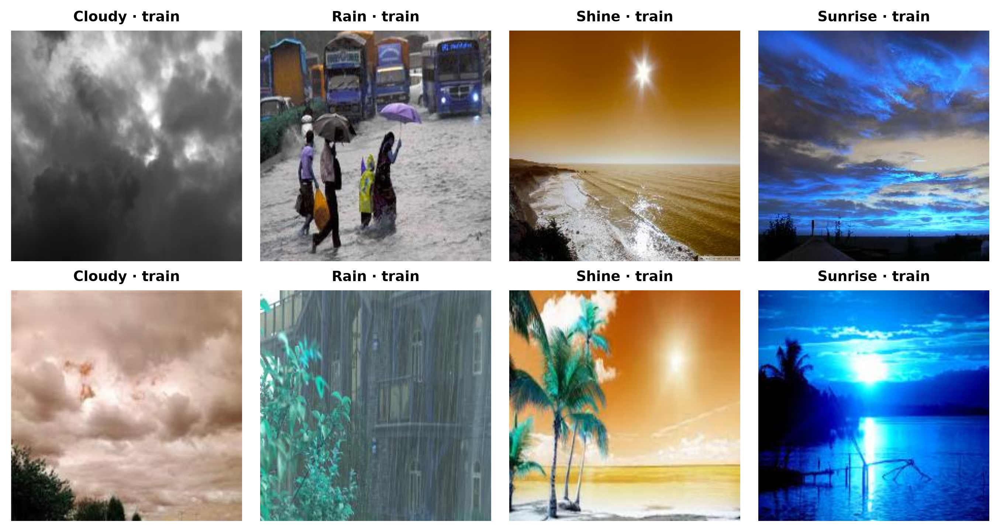
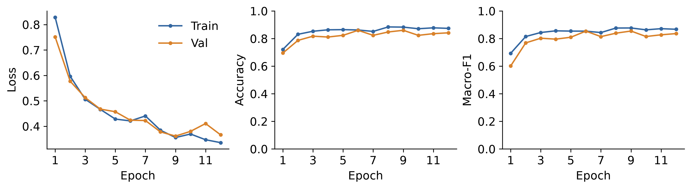
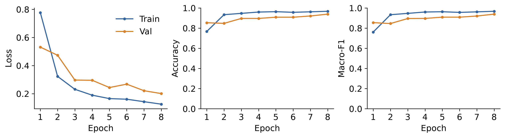
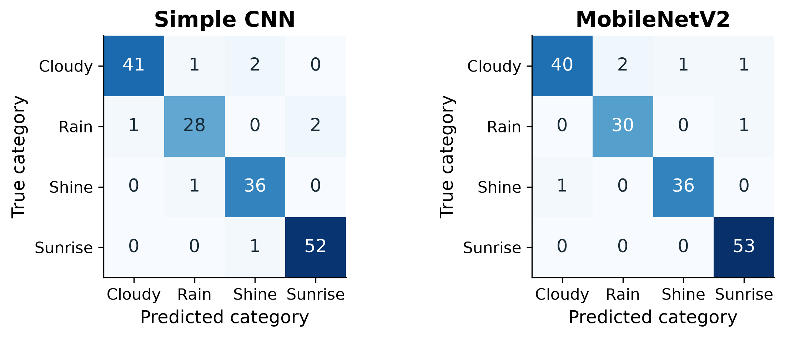

# WeatherVision: Weather Image Classification

**Assignment 1**

**Author:** Rakhman Seidigali

**Group:** SE-2411

**Course:** Computer Vision, Astana IT University

**Instructor:** Nurym Kaiyrkhan

## Abstract

This assignment compares a Simple CNN trained from scratch with ImageNet-pretrained MobileNetV2 for classifying outdoor photographs as Cloudy, Rain, Shine, or Sunrise. The dataset contains 1,097 images after duplicate removal, divided into 768 training, 164 validation, and 165 test images. Both models use cross-entropy loss, AdamW, training augmentation, and validation macro-F1 checkpoint selection. MobileNetV2 achieves 96.36% test accuracy and 0.9620 macro-F1, compared with 95.15% and 0.9477 for the CNN. Class-wise results show higher Rain and Sunrise recall for MobileNetV2. Simple CNN provides a smaller network and a shorter forward-pass time. The application displays the predicted category, four scores, and inference information for either model.

## 1. Introduction and objective

Weather image classification uses cloud texture, reflected light, rain patterns, and horizon colors to identify the category of a photograph. These cues appear at different spatial scales. Small regions may contain rain streaks or edges, while a larger part of the image describes the sky and overall lighting. Convolutional networks combine these local and wider visual patterns through successive feature layers.

The baseline approach learns its filters from the weather images. The improved approach reuses a feature extractor trained on ImageNet and learns a new classifier for the four labels. Comparing them shows how a compact network and a pretrained representation behave on the same task.

The assignment has three objectives: construct a four-class CNN baseline, adapt MobileNetV2 through transfer learning, and compare their predictions and computational requirements. Accuracy describes overall correctness, while precision, recall, and macro-F1 describe class balance. Learning curves show the optimization process, and confusion matrices identify the remaining classification errors.

The workflow consists of dataset preparation, image preprocessing, model training, validation-based checkpoint selection, and test evaluation. The trained models are then used in a Streamlit interface for uploading and classifying photographs. This baseline comparison also supplies the starting point for the ConvNeXt extension in Assignment 2.

<!-- pagebreak -->

## 2. Dataset and preprocessing

The experiments use the Multi-class Weather Dataset for Image Classification by Gbeminiyi Ajayi [1], downloaded from the PerceptiLabs mirror. It contains RGB photographs with the labels Cloudy, Rain, Shine, and Sunrise. Cloudy images contain cloud structures, Rain images include rain or wet-scene patterns, Shine images show bright sunlight, and Sunrise images emphasize warm horizon lighting.

The dataset contains 1,123 weather images. Removing 26 duplicate images leaves 1,097 images for training and evaluation. The retained collection has 291 Cloudy, 205 Rain, 249 Shine, and 352 Sunrise images. The class distribution makes macro-averaged metrics useful because each category contributes equally to their final value.

**Table 1. Dataset partition by class.**

| Category | Train | Validation | Test | Total |
| --- | --- | --- | --- | --- |
| Cloudy | 204 | 43 | 44 | 291 |
| Rain | 143 | 31 | 31 | 205 |
| Shine | 175 | 37 | 37 | 249 |
| Sunrise | 246 | 53 | 53 | 352 |

Exact duplicates are removed using file and decoded-pixel hashes. Near duplicates are grouped using pHash, dHash, aspect ratio, and thumbnail color difference. Group assignment precedes the approximately 70/15/15 split. With seed 42, the split contains 768 training, 164 validation, and 165 test photographs. Both models use this membership.

The shorter image side is resized to 256 pixels, followed by a 224 by 224 center crop. Each RGB channel is scaled to the range from zero to one and normalized using the ImageNet mean and standard deviation. Subtracting the channel mean and dividing by its standard deviation gives the input scale used by the pretrained feature extractor. The class indices are cloudy=0, rain=1, shine=2, and sunrise=3.

Training augmentation applies horizontal flips with probability 0.5, rotations between -8 and 8 degrees, and mild color jitter. Brightness and contrast vary by up to 15%, and saturation by up to 10%. This supplies alternate views of the training photographs. Validation and test images use fixed resizing, cropping, and normalization.

<!-- pagebreak -->

## 3. Model architectures

**Simple CNN.** The baseline uses three 3x3 convolutional blocks with 16, 32, and 64 output channels. Batch normalization controls the activation scale, ReLU introduces a nonlinear response, and max pooling reduces spatial resolution. Global average pooling produces a 64-element feature vector. Dropout with probability 0.25 precedes a four-output linear classifier. All 23,956 parameters are trainable.

**Table 2. Simple CNN feature dimensions.**

| Stage | Output shape | Operation |
| --- | --- | --- |
| Input | 3 x 224 x 224 | RGB image |
| Block 1 | 16 x 112 x 112 | Conv, BN, ReLU, pool |
| Block 2 | 32 x 56 x 56 | Conv, BN, ReLU, pool |
| Block 3 | 64 x 28 x 28 | Conv, BN, ReLU, pool |
| Classifier | 4 logits | Global pool, dropout, linear |

**MobileNetV2.** MobileNetV2 [2] uses inverted residual blocks. Pointwise convolution expands the channels, depthwise convolution performs spatial filtering, and a linear projection reduces the representation. The pretrained backbone produces a 1,280-element feature vector. A new four-class linear head contains 5,124 trainable parameters. The feature extractor is frozen and remains in evaluation mode, preserving its batch-normalization statistics.

## 4. Training and evaluation

**Table 3. Training settings.**

| Model | Epoch limit | Batch | LR | Patience |
| --- | --- | --- | --- | --- |
| Simple CNN | 12 | 32 | 0.001 | 4 |
| MobileNetV2 | 8 | 32 | 0.001 | 4 |

The models output four logits. Softmax converts these into class scores, and cross-entropy minimizes the negative log score of the target label. AdamW uses weight decay 0.0001. Training shuffles mini-batches and uses seed 42. Each epoch includes a validation pass; the highest validation macro-F1 selects the checkpoint. Early stopping has a patience of four non-improving epochs.

Accuracy is the fraction of correct predictions. Precision measures the correct fraction of a class's predicted labels, and recall measures the fraction of its true images recovered. Per-class F1 is `2PR / (P + R)`; macro-F1 averages the four class values. Training used Apple MPS on macOS with Python 3.14.5, PyTorch 2.10.0, and TorchVision 0.25.0.

<!-- pagebreak -->

## 5. Test results and learning behavior

**Table 4. Classification performance on the 165 test images.**

| Model | Accuracy | Macro P | Macro R | Macro F1 |
| --- | --- | --- | --- | --- |
| Simple CNN | 0.9515 | 0.9489 | 0.9473 | 0.9477 |
| MobileNetV2 | 0.9636 | 0.9624 | 0.9625 | 0.9620 |

Simple CNN correctly classifies 157 test images, and MobileNetV2 classifies 159. CNN training loss decreases from 0.829 to 0.335; MobileNetV2 loss decreases from 0.777 to 0.125. Validation macro-F1 selects epoch 9 for the CNN and epoch 8 for MobileNetV2.

<!-- pagebreak -->

## 6. Class-wise analysis and computational cost

**Table 5. Per-class F1 for the two models.**

| Class | CNN F1 | MobileNet F1 | Test images |
| --- | --- | --- | --- |
| Cloudy | 0.9535 | 0.9412 | 44 |
| Rain | 0.9180 | 0.9524 | 31 |
| Shine | 0.9474 | 0.9730 | 37 |
| Sunrise | 0.9720 | 0.9815 | 53 |

MobileNetV2 improves Rain recall from 28/31 to 30/31 and Sunrise recall from 52/53 to 53/53. Shine recall remains 36/37. Cloudy recall changes from 41/44 to 40/44; two Cloudy images are predicted as Rain, one as Shine, and one as Sunrise. The net result is two additional correct predictions and a macro-F1 increase from 0.9477 to 0.9620.

**Table 6. Model size, training time, and forward-pass latency.**

| Model | Parameters | Trainable | Train s | Latency ms |
| --- | --- | --- | --- | --- |
| Simple CNN | 23,956 | 23,956 | 30.6 | 0.742 |
| MobileNetV2 | 2,228,996 | 5,124 | 22.4 | 10.269 |

The CNN trains its complete 23,956-parameter network. MobileNetV2 contains 2,228,996 parameters but updates only the 5,124-parameter head. Frozen features reduce the number of weights that require gradient updates. Training and validation take 30.6 seconds for the CNN and 22.4 seconds for MobileNetV2 across their configured epochs.

Latency is the median of 30 synchronized batch-one forwards after five warm-up runs, with the input tensor on the MPS device. The CNN takes 0.742 ms and MobileNetV2 10.269 ms. Their parameter counts and operator structures produce different inference workloads.

## 7. Discussion and conclusion

MobileNetV2 has higher overall accuracy, macro precision, macro recall, and macro-F1. Its ImageNet representation supports the new task through a small linear head, while the CNN learns its filters directly from the weather images. The class-wise comparison shows that the overall gain is concentrated in Rain and Sunrise recognition. The CNN retains stronger Cloudy recall and the shortest forward time.

These results support MobileNetV2 when classification score is the priority and Simple CNN when a compact, fast model is preferred. The common four-class pipeline provides the baseline for the ConvNeXt comparison in Assignment 2.

**Execution.** Train with `python weather_cv.py train --run cnn_baseline` and `python weather_cv.py train --run mobilenet_improved`. Launch with `python -m streamlit run app.py`.

## References

[1] Ajayi, G. (2018). Multi-class Weather Dataset for Image Classification. Mendeley Data, V1. [DOI: 10.17632/4drtyfjtfy.1](https://doi.org/10.17632/4drtyfjtfy.1).

[2] Sandler, M., Howard, A., Zhu, M., Zhmoginov, A., and Chen, L.-C. (2018). MobileNetV2: Inverted Residuals and Linear Bottlenecks. CVPR, pp. 4510-4520. [Paper](https://arxiv.org/abs/1801.04381).
