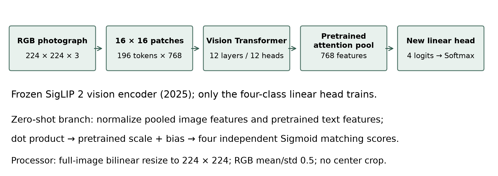
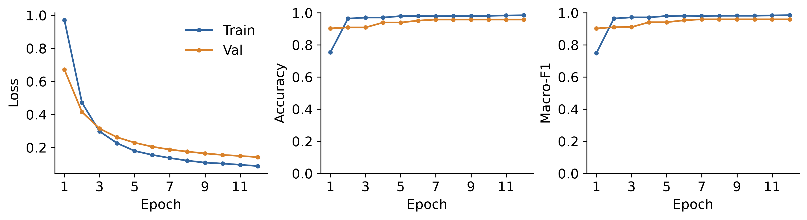
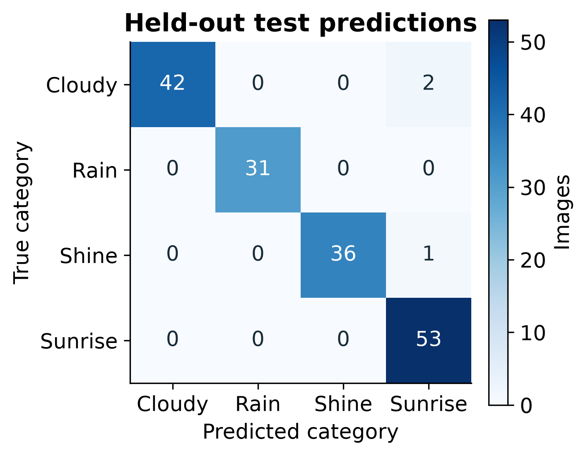
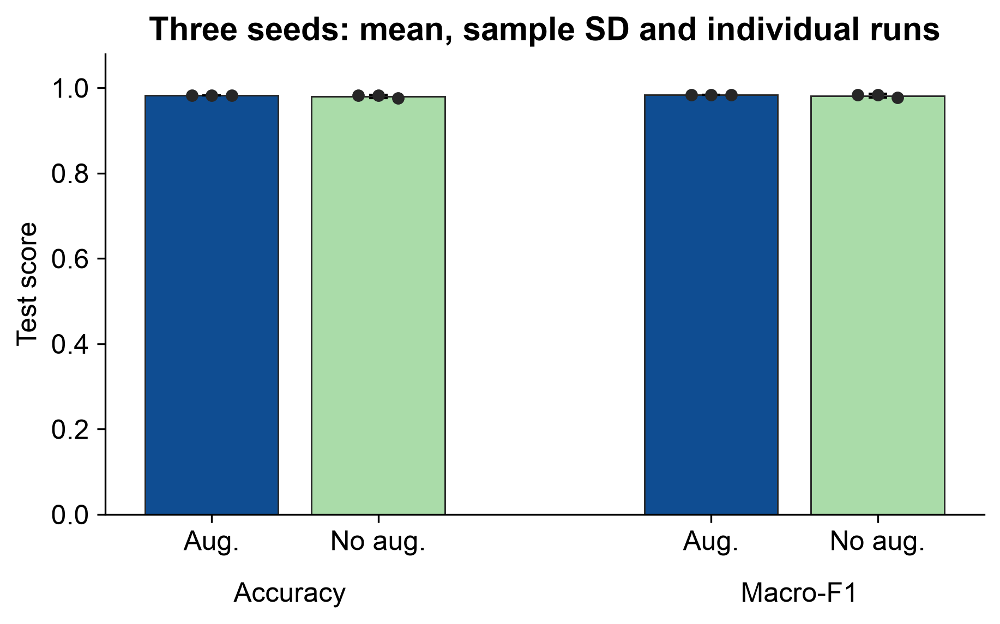
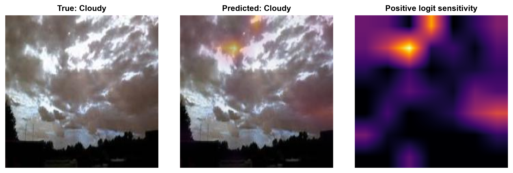
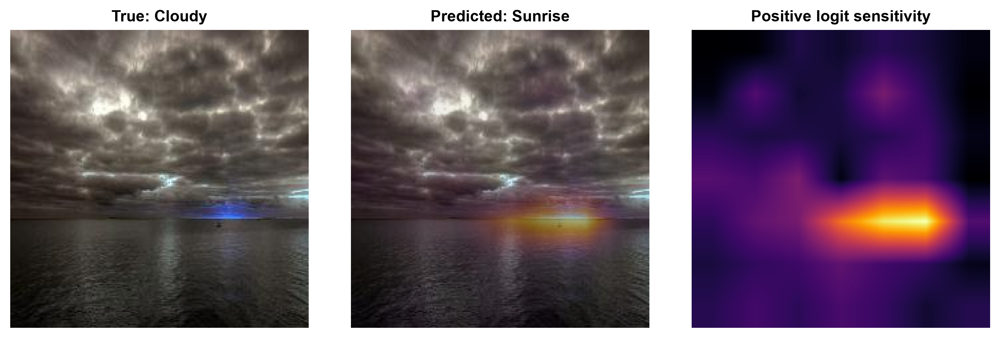
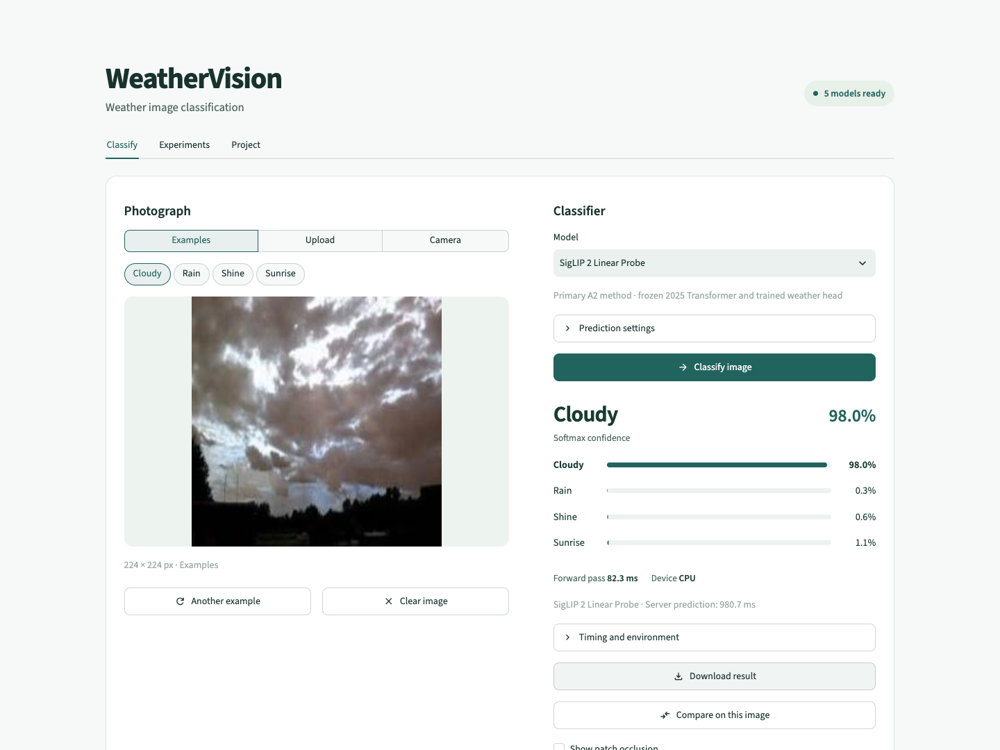

# WeatherVision: SigLIP 2 for Weather Image Classification

**Assignment 2 - Rakhman Seidigali, SE-2411**

Computer Vision, Astana IT University. Instructor: Nurym Kaiyrkhan.

## 1. Introduction and motivation

WeatherVision assigns Cloudy, Rain, Shine or Sunrise to an outdoor photograph. Assignment 1 established a Simple CNN and frozen-feature MobileNetV2 comparison. This revision introduces Google's SigLIP 2 (2025) as the primary advanced method, while preserving ConvNeXt-Tiny as a historical A2 experiment. The goal is to evaluate modern visual-semantic representations on a small labeled dataset, rather than assume a newer model must win.

SigLIP 2 is a vision-language model pretrained on WebLI with an image-text objective and additional representation-learning techniques [2]. Its visual encoder can be used with text descriptions without fitting a weather classifier, or with a newly trained linear head. Comparing these routes separates pretrained semantic matching from supervised adaptation to the four labels.

**Measured findings.** On the fixed 165-image test set, zero-shot SigLIP 2 obtains 93.33% accuracy and 0.9366 macro-F1. The predeclared seed-42 augmented linear probe obtains 98.18% and 0.9839. Its accuracy is equal to historical augmented ConvNeXt's 98.18%. Three matched seeds were completed for each augmentation treatment. All figures and tables derive from saved predictions and histories; no original experiment was retrained or relabeled.

The contribution is a reproducible comparison, a functioning Transformer-based application and an explicit image-region sensitivity explanation. It is not a claim of universal superiority, calibrated certainty or causal understanding. The following sections describe the unchanged data, official preprocessing, frozen-backbone protocol and measured outcomes.

<!-- pagebreak -->

## 2. Dataset and preprocessing

Ajayi's Multi-class Weather Dataset [1] is used through the resized PerceptiLabs mirror, pinned to commit ad78ac8fcf1b1aae229ca6e5310aa75b06783787. The collection has 1,123 valid photographs. Removing 26 exact copies retains 1,097 images in 1,011 detected groups. File and decoded-pixel SHA-256 identify exact duplicates. Conservative pHash/dHash, aspect-ratio and thumbnail-color criteria group near duplicates before splitting. Detected groups remain in a single partition.

| Class | Train | Validation | Test |
|---|---:|---:|---:|
| Cloudy | 204 | 43 | 44 |
| Rain | 143 | 31 | 31 |
| Shine | 175 | 37 | 37 |
| Sunrise | 246 | 53 | 53 |
| Total | 768 | 164 | 165 |

The original manifest and seed 42 remain unchanged. SigLIP 2 uses its official image processor: bilinear full-image resize to 224 by 224, rescaling by 1/255 and RGB means/standard deviations of 0.5. Unlike historical ConvNeXt, it has no center crop or ImageNet channel statistics. This resize can distort aspect ratio, a limitation of the selected fixed-resolution checkpoint.

Training augmentation applies random resized crop (scale 0.8-1.0, ratio 0.9-1.1) and horizontal flip with probability 0.5 before the official processor. Weather color is preserved by omitting color jitter; no rotation introduces black corners. Validation and test images are deterministic.

<!-- pagebreak -->

## 3. SigLIP 2 architecture and adaptation

The exact checkpoint is google/siglip2-base-patch16-224, revision 75de2d55ec2d0b4efc50b3e9ad70dba96a7b2fa2, Apache-2.0 [3]. Transformers 4.57.6 provides its fixed-resolution SiglipVisionModel/SiglipModel API. The API's siglip model type does not mean older SigLIP weights were substituted. Genuine CPU and MPS forward passes verified the cached official weights and preprocessing.

A Vision Transformer divides the image into 196 non-overlapping 16-square patches [4]. Patch embeddings and positional information feed twelve Transformer layers with twelve attention heads and 768-dimensional features. Self-attention relates spatial tokens across the image; feed-forward blocks transform their representations. The pretrained attention-pooling head produces one 768-element image vector. This model does not require an invented CLS/register-token average.

**Zero-shot branch.** The pretrained text encoder produces vectors for four English descriptions. Image/text vectors are normalized; their dot products receive the pretrained logit scale and bias. Sigmoid produces four independent image-text matching scores. They do not sum to one and are not calibrated class probabilities. Three prespecified prompt sets were compared on validation data only; set 2 was selected by macro-F1. The selected prompts are cloudy weather, rainy weather, sunny weather and sunrise. Its frozen text vectors are cached for inference.

**Linear probe.** The official attention-pooled visual representation feeds a new Linear(768,4) head. Cross-entropy trains only 3,076 head parameters; the 92,884,224-parameter encoder remains frozen and in evaluation mode. Supervised Softmax scores sum to one but remain uncalibrated. This is linear probing, not full-backbone fine-tuning.

<!-- pagebreak -->

## 4. Experimental setup and selection

Both supervised treatments use seeds 42, 43 and 44, cross-entropy, AdamW, learning rate 0.001, weight decay 0.0001, head batch size 32, up to 25 epochs and early-stopping patience five. The larger epoch budget allows adaptation beyond historical ConvNeXt's six epochs. All settings are fixed across augmentation treatments; the main demonstration is the predeclared augmented seed-42 model, independent of test performance.

The frozen encoder runs on Apple MPS, with correct CPU/CUDA support. Deterministic train-without-augmentation and validation features may be cached. Augmented training representations are generated anew for every seed and epoch. No single cached deterministic view is misrepresented as dynamic augmentation. The lightweight head is optimized on CPU over the extracted features, with independent epoch-seeded shuffling. Backbone gradients are never stored.

Highest validation macro-F1 selects the checkpoint; ties keep the earliest epoch. Initial-head hashes match within each seed's augmentation pair. Prompt selection and all six supervised runs completed before a selection lock was written and new methods accessed the test set. Test labels select neither prompts nor epochs.

The augmented seed-42 run selected epoch 7 and reached validation macro-F1 0.9591. Its recorded wall time was 155.8 s, including feature extraction and head optimization. Cache reuse makes elapsed times dependent on cache state; historical training times cover a narrower original scope. All six histories, selected heads and test predictions are retained. Single-device timing is descriptive, not a portable hardware guarantee.

<!-- pagebreak -->

## 5. Results and comparison with Assignment 1

**Table 1. Fixed-test classification results.**

| Model | Accuracy | Macro P | Macro R | Macro-F1 |
| --- | --- | --- | --- | --- |
| Simple CNN / A1 | 95.15% | 0.9489 | 0.9473 | 0.9477 |
| MobileNetV2 / A1 | 96.36% | 0.9624 | 0.9625 | 0.9620 |
| ConvNeXt + aug. / historical | 98.18% | 0.9866 | 0.9795 | 0.9827 |
| ConvNeXt no aug. / historical | 97.58% | 0.9798 | 0.9727 | 0.9759 |
| SigLIP 2 zero-shot | 93.33% | 0.9330 | 0.9421 | 0.9366 |
| SigLIP 2 + aug. / seed 42 | 98.18% | 0.9866 | 0.9819 | 0.9839 |
| SigLIP 2 no aug. / seed 42 | 98.18% | 0.9866 | 0.9819 | 0.9839 |

The supervised seed-42 SigLIP 2 accuracy is equal to ConvNeXt's historical result. The frozen visual-semantic representation and small weather head operate under a different pretraining and preprocessing recipe; model year alone does not determine performance. Zero-shot uses no weather-label optimization, while its prompt choice uses validation labels. The supervised head has access to the 768 labeled training images.

**Table 2. Recorded model size, training time and new common-protocol latency.**

| Model | Parameters / trainable | Train s | Mean forward ms |
| --- | --- | --- | --- |
| Simple CNN | 23,956 / 23,956 | 30.6 | 1.08 |
| MobileNetV2 | 2,228,996 / 5,124 | 22.4 | 5.59 |
| ConvNeXt / historical | 27,823,204 / 3,076 | 39.0 | 6.23 |
| SigLIP 2 zero-shot | 92,884,224 / 0 | 0.0 | 21.97 |
| SigLIP 2 probe / s42 | 92,887,300 / 3,076 | 155.8 | 19.24 |

The latency column is a new common-device benchmark (MPS): batch one, five warm-ups and thirty synchronized network forwards on the same first test photograph with each model's correct processor. It excludes decoding, preprocessing, transfer, loading and Softmax/Sigmoid. Zero-shot text vectors are cached; text encoding is excluded. Historical benchmark files remain unchanged. Training-time scopes and feature-cache reuse differ, so these values should not be interpreted as a controlled training-efficiency experiment.

<!-- pagebreak -->

## 6. Three-seed augmentation ablation

Each pair changes only the augmentation treatment. Architecture, revision, split, head initialization seed, optimizer, batch size, epoch cap and validation selection are fixed. Per-seed checkpoint selection remains independent of test performance.

**Table 3. Individual runs.**

| Seed | Aug. | Accuracy | Macro-F1 | Best epoch |
| --- | --- | --- | --- | --- |
| 42 | Yes | 98.18% | 0.9839 | 7 |
| 42 | No | 98.18% | 0.9839 | 5 |
| 43 | Yes | 98.18% | 0.9839 | 6 |
| 43 | No | 98.18% | 0.9839 | 11 |
| 44 | Yes | 98.18% | 0.9839 | 7 |
| 44 | No | 97.58% | 0.9769 | 4 |

**Table 4. Descriptive aggregation (sample standard deviation, ddof=1).**

| Treatment | Accuracy mean / SD | Macro-F1 mean / SD | Seeds |
| --- | --- | --- | --- |
| No augmentation | 97.98% / 0.35% | 0.9816 / 0.0040 | 3 |
| Augmentation | 98.18% / 0.00% | 0.9839 / 0.0000 | 3 |

Three seeds expose variation hidden by a single run, but remain too few for a broad significance claim. Differences should be read together with the 165-image denominator and class-wise precision/recall/F1. The repository retains per-class scores for every seed. Augmentation changes the views presented to a frozen encoder; it can improve robustness or remove useful weather cues. Neither direction is assumed before measurement.

<!-- pagebreak -->

## 7. Transformer-compatible explainability

Class-conditioned image-region occlusion measures sensitivity of the original predicted class logit. The model-visible 224-square tensor is divided into 49 equal 32-square regions, each covering two by two native ViT patches. One region at a time is replaced by normalized zeros, the checkpoint RGB mean of 0.5. Batched inference measures original logit minus occluded logit while holding the target class fixed.

Signed drops are retained. Positive drops are normalized for display and mapped through the processor's full-image resize onto the photograph. Opacity changes blending, not measured importance. A single-region independent recomputation matches the batched result; deterministic settings and raw signed maps are saved. The interface explicitly calls this occlusion, not Grad-CAM or native Transformer attention.

These interventions create artificial images. Regions interact through attention, and positive-only overlays omit suppressive responses. A coarse grid, one replacement baseline and selected examples do not establish segmentation or causal understanding. The map probes the trained model's response, not ground-truth weather localization. Historical ConvNeXt Grad-CAM remains available as a different explanation method.

<!-- pagebreak -->

## 8. Application, ethics, limitations and conclusion

The Streamlit application defaults to the genuinely trained SigLIP 2 Linear Probe. It also offers zero-shot matching, Simple CNN, MobileNetV2 and historical ConvNeXt. Upload, camera and dataset-example workflows show four clearly labeled scores, device/environment information, latency and downloadable results. Model/processor caching avoids reloads on ordinary reruns. Missing assets produce a setup error; another model is never presented as SigLIP 2. Inference works offline after installation.

The dataset is attributed under CC BY 4.0; the pretrained checkpoint is Apache-2.0. No generated photographs enter training. Uploaded images stay in server memory. Users should avoid sensitive photographs on shared servers. The previous video demonstrates ConvNeXt and is labeled historical; the revised recording materials describe actual SigLIP 2 behavior.

Limitations include small and ambiguous class labels, heuristic duplicate grouping, only three head-training seeds, frozen features, fixed-resolution distortion and imperfect explanations. Pretrained visual-semantic representations are relevant because they support both label-free semantic matching and adaptation with limited labeled data. The measured outcomes support that comparison without asserting universal superiority. Source code, checkpoints, histories, prompt selection, predictions and an executed complete notebook document reproducibility.

**References**

[1] Ajayi (2018). Multi-class Weather Dataset. DOI: 10.17632/4drtyfjtfy.1. PerceptiLabs mirror, pinned commit ad78ac8.

[2] Tschannen et al. (2025). SigLIP 2: Multilingual Vision-Language Encoders with Improved Semantic Understanding, Localization, and Dense Features. arXiv:2502.14786.

[3] Google. Official checkpoint/model card: https://huggingface.co/google/siglip2-base-patch16-224. Transformers 4.57 SigLIP API: https://huggingface.co/docs/transformers/v4.57.1/en/model_doc/siglip.

[4] Dosovitskiy et al. (2020/2021). An Image is Worth 16x16 Words. arXiv:2010.11929. Official SigLIP 2 implementation: google-research/big_vision.

[5] Sandler et al. (2018), MobileNetV2, arXiv:1801.04381; Liu et al. (2022), ConvNeXt, arXiv:2201.03545; Selvaraju et al. (2017), Grad-CAM, arXiv:1610.02391.
