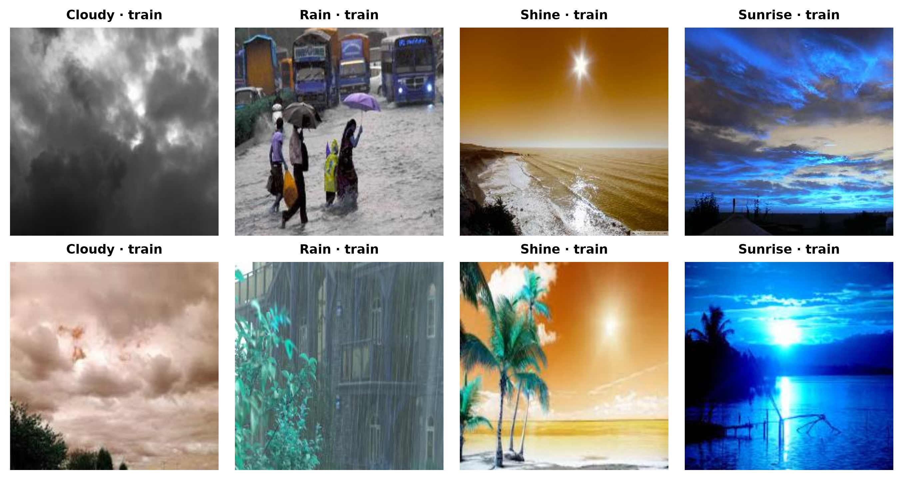
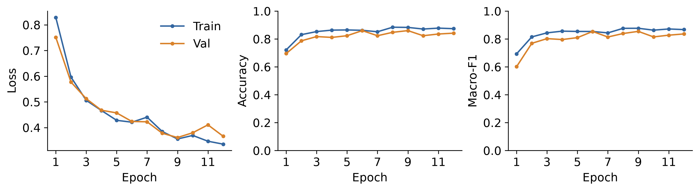
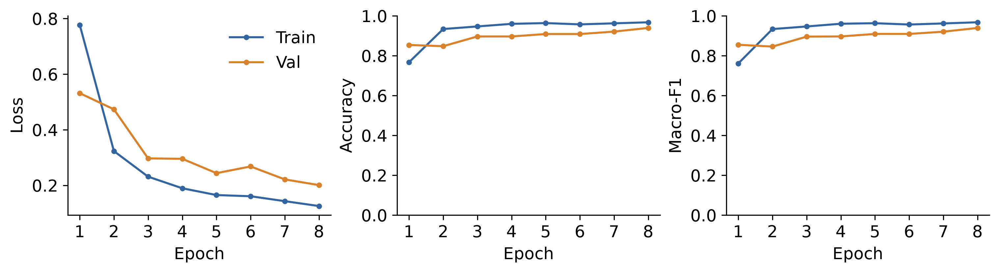
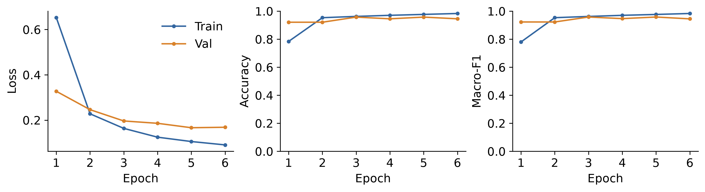
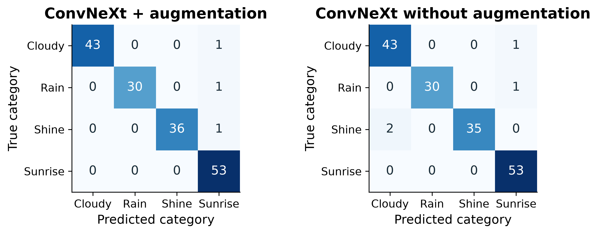
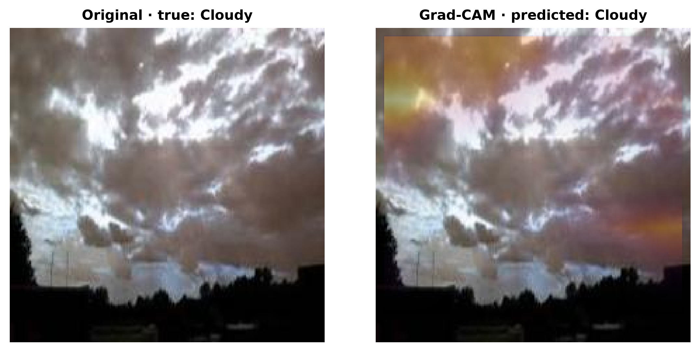
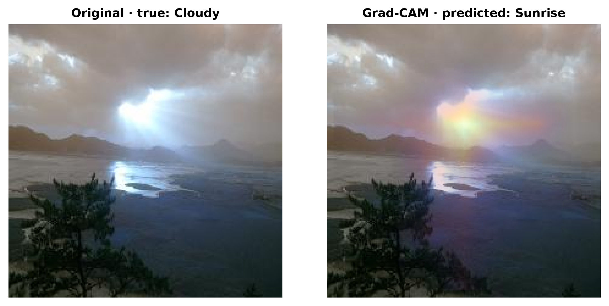

# WeatherVision: Weather Image Classification Using Deep Learning and Transfer Learning

**Assignment 2**

**Author:** Rakhman Seidigali

**Group:** SE-2411

**Course:** Computer Vision, Astana IT University

**Instructor:** Nurym Kaiyrkhan

## Abstract

WeatherVision classifies outdoor photographs into Cloudy, Rain, Shine, and Sunrise using Simple CNN, MobileNetV2, and ConvNeXt-Tiny. After duplicate removal, 1,097 images are divided into training, validation, and test sets. The Simple CNN learns its features from scratch; the transfer models use frozen ImageNet feature extractors with new four-class heads. Validation macro-F1 selects the training checkpoint. Test accuracy reaches 95.15% for Simple CNN, 96.36% for MobileNetV2, 98.18% for augmented ConvNeXt, and 97.58% for ConvNeXt without augmentation. The ConvNeXt augmentation ablation produces one additional correct prediction and raises macro-F1 from 0.9759 to 0.9827. Class-wise analysis identifies the remaining confusions, and Grad-CAM visualizes the spatial features associated with a prediction. A Streamlit application combines image upload, model selection, class scores, inference timing, and heatmap display.

## 1. Introduction

Weather image classification assigns a visual category to an outdoor photograph. Cloud texture, rain streaks, wet surfaces, direct sunlight, and horizon colors provide useful cues. Their appearance changes with camera position, exposure, background content, and lighting. A classifier must combine local textures with the wider composition of the scene to distinguish the four categories.

A convolutional neural network learns filters that respond to spatial patterns. Early layers detect simple structures such as edges and color transitions. Deeper layers combine those responses into more complex representations. A small CNN learns these filters directly from the weather images. Transfer learning starts with filters learned from ImageNet and adapts a new classifier to the target labels.

The project compares these approaches through Simple CNN, MobileNetV2, and ConvNeXt-Tiny. The comparison includes classification accuracy, macro precision, macro recall, macro-F1, parameter count, training behavior, and forward-pass latency. This connects prediction quality with the computational requirements of an interactive application.

Assignment 1 establishes the Simple CNN and MobileNetV2 comparison. Assignment 2 adds ConvNeXt-Tiny, evaluates training augmentation through a paired experiment, and uses Grad-CAM to examine class-related spatial features. The three model families share one data-loading and evaluation pipeline and are available in the same Streamlit interface.

<!-- pagebreak -->

## 2. Dataset and preprocessing

The experiments use the Multi-class Weather Dataset for Image Classification by Gbeminiyi Ajayi [1], downloaded from the PerceptiLabs mirror [5]. The mirror contains 224 by 224 RGB photographs labeled Cloudy, Rain, Shine, and Sunrise. Cloudy images emphasize cloud structures; Rain images include rain or wet-scene cues; Shine images show bright sunlight; Sunrise images contain characteristic horizon lighting.

The dataset contains 1,123 weather images. Removing 26 duplicate images leaves 1,097 images for training and evaluation. The retained classes contain 291 Cloudy, 205 Rain, 249 Shine, and 352 Sunrise photographs. Sunrise is the largest class, while Rain is the smallest. Macro-averaged metrics give these categories equal weight during the comparison.

**Table 1. Dataset partition by class.**

| Category | Train | Validation | Test | Total |
| --- | --- | --- | --- | --- |
| Cloudy | 204 | 43 | 44 | 291 |
| Rain | 143 | 31 | 31 | 205 |
| Shine | 175 | 37 | 37 | 249 |
| Sunrise | 246 | 53 | 53 | 352 |

Duplicate removal precedes the approximately 70/15/15 split. File and decoded-pixel hashes identify exact copies. Near-duplicate detection combines pHash and dHash distances of at most four bits, a log-aspect-ratio difference at most 0.10, and thumbnail RGB RMSE at most 0.12. Detected image groups remain within one partition. The split uses seed 42 and contains 768 training, 164 validation, and 165 test images.

The shorter image side is resized to 256 pixels for Simple CNN and MobileNetV2, or 236 pixels for ConvNeXt, followed by a 224-square center crop. RGB channels use means [0.485, 0.456, 0.406] and standard deviations [0.229, 0.224, 0.225]. This places the inputs on the scale expected by the pretrained feature extractors.

RGB values are scaled to [0, 1] before normalization: `x_norm = (x - mean) / std`. All training photographs come from the cited dataset; the synthetic/generated training-image share is 0%. Augmentation transforms these photographs during loading without adding generated files.

Training augmentation applies a horizontal flip with probability 0.5, rotation between -8 and 8 degrees, and color jitter. Brightness and contrast factors vary from 0.85 to 1.15, and saturation from 0.90 to 1.10. These operations vary composition and illumination while retaining the image label. Validation and test preprocessing use the fixed resize, crop, and normalization operations.

<!-- pagebreak -->

## 3. Advanced architecture: ConvNeXt-Tiny

ConvNeXt was introduced in 2022 as a modernized convolutional architecture [3]. It adapts hierarchical CNN design with large depthwise kernels, LayerNorm, and channel-expansion blocks. It is appropriate for WeatherVision because cloud texture, wet surfaces, and broad lighting patterns require both local and wider spatial features. Its pretrained representation can be adapted through a small classification head on this dataset.

![Figure 2. WeatherVision ConvNeXt-Tiny. Shapes are channels x height x width; block counts and dimensions follow TorchVision [6].](../outputs/convnext_architecture.png)

**Feature hierarchy.** A 4x4 convolution with stride four creates 96 feature channels at 56x56 resolution from a 224x224 RGB input. Four stages contain 3, 3, 9, and 3 blocks. Between stages, normalization and a stride-two convolution reduce spatial size while increasing channels. The final stage produces 768 feature maps of size 7x7. This hierarchy represents fine texture in earlier stages and wider scene structure in later stages.

**Inside a block.** A 7x7 depthwise convolution filters each channel independently. LayerNorm stabilizes the feature scale. Two linear projections expand the channels from C to 4C and return them to C, with GELU between them. A learned layer scale controls the residual branch, which is added to the block input. Residual connections preserve information through the deeper network. Stochastic depth is disabled in the frozen extractor used here.

**Four-class adaptation.** TorchVision ImageNet-1K V1 weights initialize the network [6]. Global average pooling and pretrained LayerNorm produce a 768-element vector. A new Linear(768, 4) layer outputs the weather logits. Its 3,076 parameters train; the backbone and normalization weights remain frozen. ConvNeXt has 27,823,204 parameters after replacing the original ImageNet head. Input preprocessing uses a 236-pixel short side, a 224-square center crop, and ImageNet channel normalization.

**Comparison with the A1 models.** Simple CNN has three Conv-BatchNorm-ReLU-Pool blocks with 16, 32, and 64 channels, global pooling, dropout 0.25, and a four-class head. It learns all 23,956 parameters from scratch. MobileNetV2 [2] uses inverted residual blocks with channel expansion, depthwise filtering, and linear bottlenecks; its 1,280-element representation feeds a 5,124-parameter head. ConvNeXt adds a deeper hierarchy, larger spatial kernels, LayerNorm, and GELU. These differences provide a suitable modern extension to the A1 comparison and are evaluated on the same held-out images.

<!-- pagebreak -->

## 4. Experimental setup and model comparison

**Table 2. Training configurations.**

| Run | Epoch limit | Batch | LR | Aug. |
| --- | --- | --- | --- | --- |
| Simple CNN | 12 | 32 | 0.001 | True |
| MobileNetV2 | 8 | 32 | 0.001 | True |
| ConvNeXt + aug. | 6 | 16 | 0.001 | True |
| ConvNeXt no aug. | 6 | 16 | 0.001 | False |

Cross-entropy and AdamW use learning rate 0.001, weight decay 0.0001, and seed 42. Simple CNN trains all weights; transfer models train only their new linear heads. Frozen extractors remain in evaluation mode. Validation macro-F1 selects the best checkpoint, retaining the earlier epoch on a tie; early-stopping patience is four. Training used Apple MPS (four CPU threads) on macOS 26.5.2 with Python 3.14.5, PyTorch 2.10.0, and TorchVision 0.25.0.

Accuracy is the proportion of correct labels. Per-class precision measures correctness among predicted labels; recall measures recovery of true labels. F1 is `2PR / (P + R)`. Macro precision, recall, and F1 average the four class-specific values equally. The 165 test images are reserved for final evaluation.

**Table 3. Held-out classification scores.**

| Model | Accuracy | Macro P | Macro R | Macro F1 |
| --- | --- | --- | --- | --- |
| Simple CNN | 0.9515 | 0.9489 | 0.9473 | 0.9477 |
| MobileNetV2 | 0.9636 | 0.9624 | 0.9625 | 0.9620 |
| ConvNeXt + aug. | 0.9818 | 0.9866 | 0.9795 | 0.9827 |
| ConvNeXt no aug. | 0.9758 | 0.9798 | 0.9727 | 0.9759 |

Augmented ConvNeXt classifies 162 images correctly, compared with 159 for MobileNetV2 and 157 for Simple CNN. Its three additional correct predictions over MobileNetV2 occur in Cloudy: recall rises from 40/44 to 43/44. Both models recover 30/31 Rain, 36/37 Shine, and 53/53 Sunrise images.

**Table 4. Parameters, total training/validation time, and MPS inference latency.**

| Model | All params | Trainable | Train s | Mean ms | Median ms |
| --- | --- | --- | --- | --- | --- |
| Simple CNN | 23,956 | 23,956 | 30.6 | 0.729 | 0.742 |
| MobileNetV2 | 2,228,996 | 5,124 | 22.4 | 12.171 | 10.269 |
| ConvNeXt + aug. | 27,823,204 | 3,076 | 39.0 | 6.716 | 6.494 |
| ConvNeXt no aug. | 27,823,204 | 3,076 | 38.1 | 6.310 | 6.273 |

Average latency is the arithmetic mean of 30 batch-one network forwards after five warm-up runs. The first test tensor resides on MPS before timing; synchronization brackets every measurement. Preprocessing, transfer, softmax, loading, and Grad-CAM are excluded. The means are 0.729 ms for CNN, 12.171 for MobileNetV2, 6.716 for augmented ConvNeXt, and 6.310 without augmentation. Median values describe the same samples. Operator structure and device kernels affect runtime as well as parameter count.

The app separately benchmarks the current image on the selected backend and displays its mean, median, and p95, plus a single forward including softmax. It reports Python, PyTorch, TorchVision, operating system, thread count, and the browser-reported User-Agent. Browser identity describes the client; CPU, CUDA, or MPS describes inference execution.

<!-- pagebreak -->

## 5. Training behavior and classification errors

**Table 5. Validation-selected epochs and test macro-F1.**

| Model | Best epoch | Validation F1 | Test F1 |
| --- | --- | --- | --- |
| Simple CNN | 9 | 0.8544 | 0.9477 |
| MobileNetV2 | 8 | 0.9390 | 0.9620 |
| ConvNeXt + aug. | 3 | 0.9579 | 0.9827 |
| ConvNeXt no aug. | 5 | 0.9570 | 0.9759 |

Simple CNN training loss decreased from 0.829 to 0.335. MobileNetV2 training loss decreased from 0.777 to 0.125. ConvNeXt + aug. training loss decreased from 0.653 to 0.091. Validation accuracy after the first epoch is 69.51% for the CNN, 85.37% for MobileNetV2, and 92.07% for augmented ConvNeXt. The transfer models reach higher first-epoch validation accuracy.

The CNN reaches its best validation macro-F1 at epoch 9. MobileNetV2 improves through epoch 8. Augmented ConvNeXt reaches 0.9579 at epochs 3 and 5, so epoch 3 is retained. Its training loss continues decreasing after that point while validation scores fluctuate.

All three augmented ConvNeXt errors are Sunrise predictions: one Cloudy, one Rain, and one Shine image. It recovers all 53 true Sunrise photographs, giving Sunrise recall of 1.0000. The three additional Sunrise predictions reduce its precision to 53/56, or 0.9464.

<!-- pagebreak -->

## 6. Augmentation ablation

The two ConvNeXt runs share the architecture, pretrained weights, initialization seed, dataset split, optimizer, learning rate, batch size, six-epoch limit, and early-stopping settings. Training augmentation is the changed factor. Each run selects a checkpoint by validation macro-F1.

**Table 6. Overall and class-wise ablation results.**

| Configuration | Test accuracy | Test macro-F1 |
| --- | --- | --- |
| ConvNeXt + aug. | 0.9818 | 0.9827 |
| ConvNeXt no aug. | 0.9758 | 0.9759 |

| Class | Aug. F1 | No aug. F1 | Difference |
| --- | --- | --- | --- |
| Cloudy | 0.9885 | 0.9663 | +0.0222 |
| Rain | 0.9836 | 0.9836 | +0.0000 |
| Shine | 0.9863 | 0.9722 | +0.0141 |
| Sunrise | 0.9725 | 0.9815 | -0.0090 |

With augmentation, accuracy was 98.18% and macro-F1 was 0.9827. Without augmentation, accuracy was 97.58% and macro-F1 was 0.9759. The two models classified 162 and 161 of 165 images correctly, respectively. The 0.61 percentage-point accuracy increase represents one additional correct image. Macro-F1 increases by 0.0068 in this single-seed comparison. Class F1 increases for Cloudy and Shine, remains equal for Rain, and decreases for Sunrise.

Without augmentation, two Shine images are predicted as Cloudy. With augmentation, Shine has one error, predicted as Sunrise. The augmented model therefore has fewer false Cloudy predictions, which raises Cloudy precision from 0.9556 to 1.0000. Its extra Sunrise false positive lowers Sunrise F1 from 0.9815 to 0.9725. The class-wise results explain the change in the overall macro average.

<!-- pagebreak -->

## 7. Grad-CAM visualization

Grad-CAM [4] gives a class-specific spatial explanation by combining feature maps and score gradients. The target is ConvNeXt's final spatial stage, `features[-1]`, before global pooling. For a selected class, gradients of its logit with respect to the spatial activations are averaged across positions. Those averages become channel weights for a weighted sum of the feature maps. ReLU retains positive responses, and normalization maps the heatmap into the range from zero to one.

The calculation enables gradients on the image input while retaining the frozen model weights. The 224-square heatmap is resized through the same geometry as the model input and placed back on the photograph. Areas outside the center crop keep the original appearance. The application presents the photograph beside the overlay, with brighter regions indicating stronger class-related attribution.

The correctly classified Cloudy example emphasizes parts of the cloud structure. The second image is labeled Cloudy but classified as Sunrise; its overlay emphasizes the bright horizon. Warm horizon lighting is therefore associated with the Sunrise score in this example. The visual comparison connects the class prediction to a spatial pattern and helps examine the errors seen in the confusion matrix.

<!-- pagebreak -->

## 8. Application, limitations, and conclusion

WeatherVision accepts uploads, camera capture, or dataset examples. It offers all three model families, four class scores, measured latency and environment details, same-image model comparison, and ConvNeXt Grad-CAM. Exports include JSON predictions, CSV comparisons, PNG overlays, and both PDF reports. The Experiments tab provides interactive metric charts, learning curves, and confusion matrices. Browser checks used Chrome 156.0.8078.80 at desktop and mobile viewport sizes.

**Ethics and limitations.** The dataset is credited under CC BY 4.0. Demo narration uses disclosed synthetic speech. Uploaded photographs stay in server memory and are not saved by the app. Users should avoid sensitive images on shared servers. The 165-image test set and single seed limit the scope of the comparison. Cloudy, Shine, and Sunrise can overlap visually; unusual lighting, camera exposure, and unseen locations may change performance. Softmax scores are uncalibrated, and Grad-CAM provides approximate spatial attribution. Further evaluation should use additional locations and repeated seeds.

**Conclusion.** Augmented ConvNeXt achieves 98.18% accuracy and 0.9827 macro-F1, ahead of MobileNetV2 and Simple CNN. The ablation adds one correct prediction. Simple CNN is the smallest and fastest model on the measured MPS workload. The application combines these models with visual explanations and exportable results.

**Reproducibility.** Install `requirements.txt`, run `python scripts/download_checkpoints.py`, then `python -m streamlit run app.py`. Dataset preparation and training commands are in README and the notebook. Repository: https://github.com/commedeschamps/WeatherVision. Demo video: https://github.com/commedeschamps/WeatherVision/releases/download/v1.0.0/WeatherVision_demo.mp4.

## References

[1] Ajayi, G. (2018). Multi-class Weather Dataset for Image Classification. Mendeley Data, V1. [DOI: 10.17632/4drtyfjtfy.1](https://doi.org/10.17632/4drtyfjtfy.1).

[2] Sandler, M., Howard, A., Zhu, M., Zhmoginov, A., and Chen, L.-C. (2018). MobileNetV2: Inverted Residuals and Linear Bottlenecks. CVPR, pp. 4510-4520. [Paper](https://arxiv.org/abs/1801.04381).

[3] Liu, Z., Mao, H., Wu, C.-Y., Feichtenhofer, C., Darrell, T., and Xie, S. (2022). A ConvNet for the 2020s. CVPR. [Paper](https://arxiv.org/abs/2201.03545v2).

[4] Selvaraju, R. R., Cogswell, M., Das, A., Vedantam, R., Parikh, D., and Batra, D. (2017). Grad-CAM: Visual Explanations from Deep Networks via Gradient-based Localization. arXiv:1610.02391v3. [Paper](https://arxiv.org/abs/1610.02391v3).

[5] PerceptiLabs. Weather-Analysis. [Dataset mirror](https://github.com/PerceptiLabs/Weather-Analysis).

[6] TorchVision 0.25. ConvNeXt-Tiny implementation and V1 preprocessing. [Official source](https://docs.pytorch.org/vision/0.25/_modules/torchvision/models/convnext.html).
